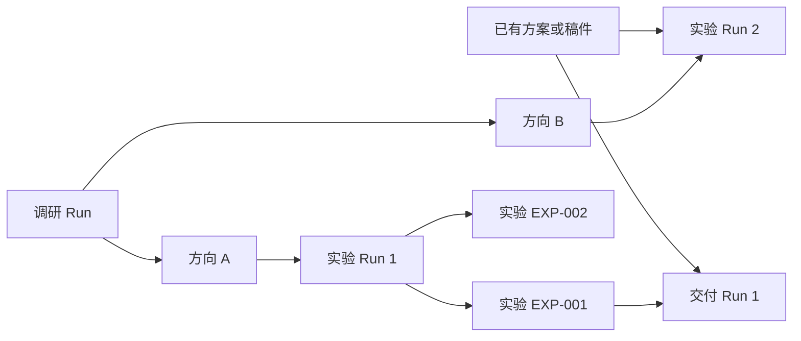

# 核心概念

当前 MIRA 把项目组织为多次独立的 **模块运行**，用明确选择的产物连接不同工作。读完本页即可区分项目、运行、实验和文件。

## Workspace 与项目

- **Workspace**：引擎配置的工作区，用于会话、组织信息、技能和相关文件。
- **Project**：具有明确目录与 `.mira/project.json` 元信息的研究或工程项目。项目目录可以由创建窗口指定，受部署策略限制。
- **Quick Chat**：不要求项目流水线的通用对话，可在需要时转成项目并保存上下文附件。

本地默认数据目录为 `~/.mira`；远程模式的数据位于 gateway 主机。所有路径都应以实际运行配置和项目目录为准。

## ModuleRun、Attempt 与 Experiment

| 概念 | 含义 | 例子 |
| --- | --- | --- |
| ModuleRun | 一次独立模块任务，拥有状态、输入、输出、对话和检查点 | “调研 1”“实验 2”“交付 1” |
| Attempt | 该 Run 的一次执行尝试；回答表单、恢复或重试可进入新 Attempt | 从确认表单后的检查点继续 |
| Experiment | 实验模块中登记的具体实验记录 | 固定划分下的基线与方法对照 |
| Artifact | 引擎发布的产物，包含类型、来源、哈希和内容引用 | CSV、报告、图片或结构化方案 |
| Candidate | 界面中可选择的方向、实验记录或交付物 | 选择 EXP-001 用于报告 |

一个 Run 可以包含多个实验和文件。Attempt 数量不是实验数量；文件数量也不是候选实验数量。

## 模块与分支

总览展示 **调研、实验、结果交付** 三栏，任何一栏都可以直接启动。引擎还支持 `planning` 规划类型。

改选上游候选后继续，会创建新的下游运行，保留已有分支。新 Run 带入显式所选的产物、记录或摘要，不自动继承其他 Run 的完整对话。

## 确认与执行模式

- **执行前确认**：本次范围的批准或修改，调研、实验和交付各自都有。
- **实验执行模式**：本次实验 Run 的 `auto` / `manual`，在启动窗口选择；manual 每个实验结束后等待决定。
- **衔接策略**：模块完成后由你选择下一步，或按规则自动创建建议的下游 Run。
- **Profile**：工程、科研、团队的执行策略，与以上控制独立。

参见 [确认与继续](./usage/ui/interactions.md)、[实验输入](./usage/ui/experiment-inputs.md) 和 [运行模式](./usage/ui/run-mode-and-profile.md)。

## 状态与证据

新模块的状态在 `<project>/.mira/modules/<run-id>/module.json`；事件在 `.mira/events.jsonl`。`waiting_input` 代表应回答当前表单；`completed` 代表模块结束并发布相应结果，仍需要审查文件与结论。

旧项目仍可能以 `task_plan.json` 为阶段和实验状态来源；不要将两种合同混用。详见 [状态与存储](./usage/ui/task-plan-and-status.md)。

## 输入范围

实验启动窗口可授权本次 Run 及其子智能体读取额外文件/目录。路径是 gateway 主机的绝对路径，授权只读，不开放外部写入，也不授权其他 Run。它是工具层的范围检查，不等于 OS 沙箱。

## Provider、模型与 Skill

- **Provider**：供应商或本地服务的接入方式。
- **Model**：实际模型名，以供应商或服务返回的可用列表为准。
- **候选模型**：为默认或团队角色模型提供有序回退列表，需配置对应 Provider。
- **Skill**：任务的步骤、模板和要求；显式选中的 Skill 会作为当前消息指令。
- **Tool**：读写文件、执行 shell、搜索或调用 MCP 的具体能力。

配置见 [Agent 配置](./usage/agent-config/README.md)。长期记忆与会话压缩见 [记忆与 Python SDK](./usage/agent-config/memory-and-sdk.md)。
