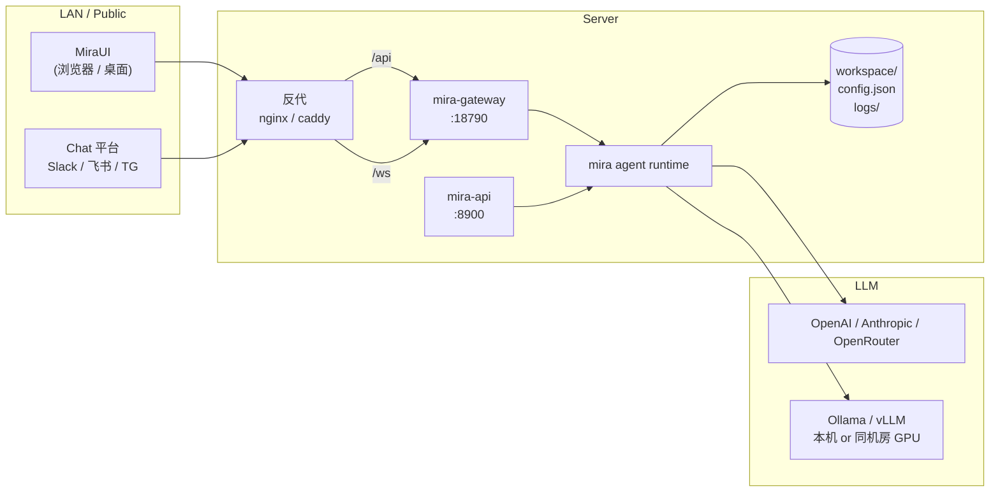

# 自托管部署（Self-hosted）

## 何时该走自托管

- 团队多人共用一份 Mira 后端 / 工作区。
- 需要从内网或外网稳定访问（不依赖某个人的笔电）。
- 想接入飞书/Slack/Telegram 等 channel，让 Agent 在群里直接响应。
- 需要 GPU 服务器跑本地 Ollama / vLLM。

## 推荐架构



## 用 docker-compose（最快）

仓库里 `deploy/` 目录包含开箱即用的模板：

```
deploy/
├── docker-compose.yml
├── Dockerfile
├── entrypoint.sh
└── .env.example
```

### 1) 准备配置与版本

```bash
cd mira/deploy
cp .env.example .env
```

`.env` 模板控制 release profile 的标签、主机端口与 UI 地址：

```bash
MIRA_AGENT_TAG=<engine-image-tag>
MIRA_UI_TAG=<ui-image-tag>
MIRA_AGENT_PORT=18790
MIRA_UI_PORT=8080
MIRA_API_URL=http://server-ip:18790/api
MIRA_WS_URL=ws://server-ip:18790/ws
```

`server-ip` 应是浏览器可达的地址，不是浏览器所在电脑的 localhost。使用与 UI 匹配的引擎版本，镜像标签是否已发布需在部署时检查；源码 tag 不代表对应镜像一定存在。

UI 连接后，Provider 首选通过 [模型供应商界面](../usage/agent-config/providers-and-runtime.md) 设置，保存到服务器当前读取的配置；Channel 与高级部署字段仍在引擎实际读取的 `config.json` 中配置。环境变量只有被传入容器后才对引擎生效；不要假定 `.env` 中任意新增 `MIRA_*` 行都会自动进入容器。

### 2) 选择一种服务组合

源码本地构建路径：

```bash
docker compose up -d mira-gateway
# 可选 OpenAI 兼容 API
docker compose up -d mira-api
```

使用 release profile 时明确指定服务，避免同时启动默认 gateway 占用同一端口：

```bash
docker compose --profile self-hosted pull mira-engine mira-ui
docker compose --profile self-hosted up -d mira-engine mira-ui
```

当前模板的 `mira-cli` 在 `cli` profile 中；`mira-api` 默认只发布主机环回的 8900。UI release 服务默认主机端口 8080，容器内 80。

检查：

```bash
curl http://127.0.0.1:18790/health
curl http://127.0.0.1:18790/version
```

UI 是静态构建；能否通过运行时容器环境改变 `VITE_*` 取决于镜像入口实现。若地址未生效，在 UI 设置中填实际端点，或按目标地址重新构建，不能只改 `.env` 就假定生效。

### 3) 暴露给前端 / nginx 反代

最小 nginx 片段：

```nginx
server {
  listen 80;
  server_name mira.example.com;

  # 静态前端
  root /var/www/mira-ui;
  index index.html;

  location / { try_files $uri /index.html; }

  # REST
  location /api/ {
    proxy_pass http://127.0.0.1:18790;
    proxy_http_version 1.1;
    proxy_set_header Host $host;
  }

  # WebSocket：此前缀同时覆盖 /ws 与 /ws/workflow/v1
  location /ws {
    proxy_pass http://127.0.0.1:18790;
    proxy_http_version 1.1;
    proxy_set_header Upgrade $http_upgrade;
    proxy_set_header Connection "upgrade";
    proxy_read_timeout 1h;
  }
}
```

UI 侧通过 `VITE_API_URL=https://mira.example.com/api` + `VITE_WS_URL=wss://mira.example.com/ws` 接入。

### 4) 持久化与外部输入

当前源码 compose 挂载主机 `~/.mira` 到 `/home/mira/.mira`；release profile 使用命名卷 `mira_data` 挂载 `/root/.mira`。按所选组合检查实际配置路径和 workspace，不要沿用旧文档假定的 `/data/*` 挂载。

备份配置、workspace，以及创建在 workspace 外的项目目录。配置包含凭据，备份时应保留访问控制。

若实验要读取额外数据，先以只读卷把数据挂进容器，再在启动窗口填写 **容器内** 绝对路径。仅填写宿主路径不会自动产生 Docker 挂载。

## 不用 Docker — 直接系统服务

适合小团队 / 单机：见 [本地服务（mira-engine）](./local-engine-service.md)。它会注册一个 launchd / systemd / Windows Service，开机自启 `mira gateway`。

## 安全 checklist

- [ ] **绝不**把 `mira gateway` 的 `0.0.0.0:18790` 直接对公网暴露；前面必须有 nginx + HTTPS + 鉴权。
- [ ] `~/.mira/config.json` 中的 API key 用文件权限 600 保护；或全部走环境变量。
- [ ] 按需要明确设置 `tools.restrictToWorkspace = true`；当前 schema 默认是 false，检查实际运行配置。
- [ ] `tools.exec.sandbox = "bwrap"`（仅 Linux 容器内）可加一层进程隔离。
- [ ] 定期 `mira-engine doctor --export` 留诊断 bundle。

## 验收检查

- [ ] `curl http://<host>:18790/api/health` 返回 200。
- [ ] 浏览器从外部访问 UI，能看到项目列表 + WebSocket 显示绿。
- [ ] 重启 docker / 重启服务器后，所有数据与项目状态保留。
- [ ] 任意用户的浏览器都看到一致的项目状态（说明真的在共享后端）。
