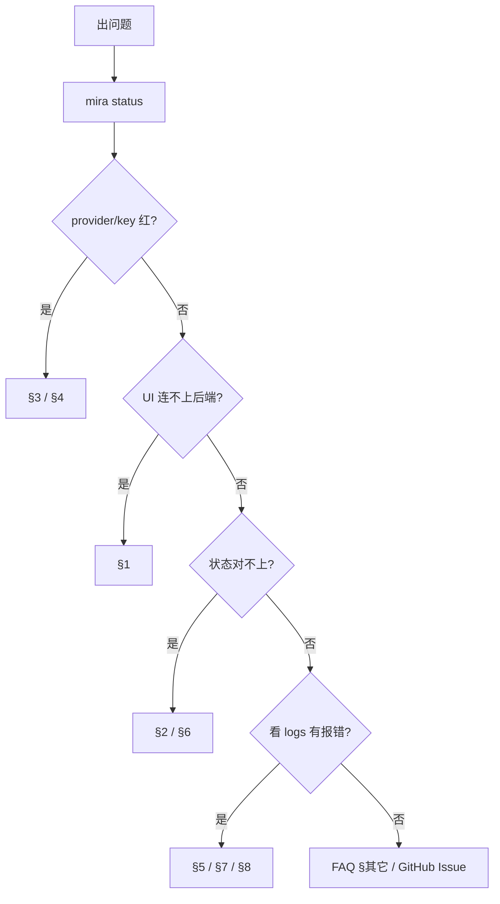

# FAQ 与故障排查

> 90% 的问题用以下三步定位：
> 1. `mira status` — 配置与 provider 是否健康。
> 2. 看 `~/.mira/logs/agent-service.log` 最近 50 行。
> 3. 确认实际项目目录：新模块查看 `.mira/modules/<run-id>/module.json`，旧项目查看 `task_plan.json`。



---

## 1. UI 无法连接后端

**症状**：右上角连接指示长时间灰/红；项目列表加载转圈。

如果你连接的是**远程部署的 mira-agent / mira gateway**，先优先排这两件事：

1. **先检查远程服务器和本地电脑的防火墙 / 安全组**
   - 远程服务器是否允许 `18790`（或你自定义的端口）入站？
   - 你本地电脑所在网络、公司 VPN、云服务器安全组、系统防火墙是否拦了这个端口？
   - 最直接的测试方式是在本地电脑上执行：
     ```bash
     curl http://<remote-host>:18790/api/health
     ```
     如果这里都超时或拒绝连接，UI 一定也连不上。
2. **局域网内访问远端机器时，后端必须监听 `0.0.0.0`，不能只绑 `127.0.0.1`**
   - 如果远端日志里看到的是：
     ```text
     Starting mira gateway on 127.0.0.1:18790
     ```
     那就只允许服务器本机访问，局域网内其他机器看不到。
   - 应改成：
     ```bash
     mira gateway --host 0.0.0.0 --port 18790
     ```
     或安装服务时：
     ```bash
     mira-engine install-service --host 0.0.0.0 --port 18790
     ```
   - 这样局域网内其他机器才能通过 `http://<server-ip>:18790` 连上。

> 注意：`0.0.0.0` 适合局域网 / 内网可达场景；**不要**把未经鉴权的 `18790` 直接暴露到公网。

排查顺序：

1. 后端起了吗？
   ```bash
   curl http://localhost:18790/api/health
   # 期望返回 {"status":"ok",...}
   ```
2. 端口对吗？UI 的 `VITE_API_URL` / `VITE_WS_URL` 与 `mira gateway --port` 一致？
3. 如果是远程 / 局域网访问，确认后端绑定的不是 `127.0.0.1`，而是 `0.0.0.0`。
4. 跨域被挡了吗？自托管反代时 nginx 的 `/ws` location 必须带 `Upgrade` / `Connection: upgrade`，详见 [自托管部署](../deployment/self-hosted.md)。
5. 防火墙 / VPN 拦了 18790？`lsof -iTCP:18790 -sTCP:LISTEN` 验证后端在听；浏览器 DevTools → Network → WS 看握手响应码。

## 2. 项目状态不一致（UI vs 文件）

先核对后端地址、workspace 和实际项目路径。新模块状态以 `.mira/modules/<run-id>/module.json` 为准，旧项目使用 `task_plan.json`。

- `waiting_input`：检查当前确认或继续表单。
- `pending_control`：暂停/取消请求等待安全边界。
- 断线后刷新项目并重连，检查快照与事件是否更新。
- 服务重启后检查暂停原因与已有文件，避免重复可能已启动的外部任务。

详见 [状态与存储](../usage/ui/task-plan-and-status.md) 与 [实时同步](../usage/ui/realtime-sync.md)。

## 3. Provider 401 / 403 / “Unauthorized”

1. 优先打开 **模型供应商**，核对启用状态、API Key、API Base 与主模型的供应商，再点 **测试连接**。密钥留空表示保留已存密钥；替换密钥需填写新值。
2. 先 **保存** 新密钥/地址，再 **从供应商拉取**；拉取不读取未保存的输入。保存后新开简短对话验证生成权限。
3. 主模型或角色使用「自动检测」时，核对模型是否匹配了预期供应商；可在活动模型中显式选择供应商。
4. Azure OpenAI 给资源根 API Base 与 key，模型用 deployment 名；纯 CLI 用户再用 `mira status` 检查实际读取的配置路径。连接测试成功也不能证明所有模型请求都可用。

详见 [Provider 与运行时参数](../usage/agent-config/providers-and-runtime.md)。

## 4. 实验已结束，但还不能继续交付

手动实验在保存每个终态记录后等待继续决定，最后一个也一样。先审查结果，再选“结束并汇总”，待所属 Run 完成后继续下游。

新模块应检查 Run 输出 Artifact 和真实交付文件；旧项目再查 `task_plan.result.output_path` 等字段。不能只看聊天中的“完成”，也不要求所有其他分支完成才能交付当前结果。

详见 [实验输入与执行](../usage/ui/experiment-inputs.md) 和 [结果交付](../usage/ui/result-center.md)。

## 5. guardrail 反复提示缺字段

1. 在 [实验详情面板](../usage/ui/experiment-detail.md) 定位是哪几个字段缺。
2. 直接在 UI 里给出具体文字（不要写 `TODO` / `待补充`，guardrail 把它们当“没填”）。
3. 如果 strict 太严打扰节奏，临时切回 Compat 走完探索期，再升回 strict 让 guardrail 一次补齐。
4. 字段或证据仍缺失时，补充真实材料或修订实验范围；切换实验执行模式不能修复缺失证据。

详见 [Guardrail 与自动修复](../usage/ui/guardrail-and-auto-repair.md)。

## 6. 端口被占（5173 / 18790 / 8900）

```bash
# macOS / Linux
lsof -iTCP:18790 -sTCP:LISTEN
# 确认配置归属后，用系统服务 stop 或指定实例 stop --gateway
```

或换端口：

```bash
mira gateway --port 28790
npm run dev -- --port 5174
```

UI 端要同步 `VITE_API_URL` / `VITE_WS_URL`。

## 7. Channel 配完没反应（Telegram / 飞书 / Slack）

通用顺序：

1. `mira channels status` 中对应 channel 是否启用？实际连接看 gateway 日志和消息收发。
2. 看 `~/.mira/logs/agent-service.log` 中以 channel 名开头的行（如 `telegram: ...`）。
3. 群里只 “@bot” 还是普通消息？`groupPolicy: mention` 必须 @；`open` 才响应所有消息。
4. `allowFrom` 里有没有把你自己加进去？空数组拒绝全部，`["*"]` 明确开放全部；具体账号列表按各通道匹配。
5. 飞书使用长连接；检查 App ID/Secret、事件订阅与权限，不配置不存在的 `/feishu/events` 回调。
6. 当前 Slack 仅支持 `socket`，检查 Bot/App Token；`events` 模式未实现。

详见 [Channel 配置](../usage/agent-config/channels.md)。

## 8. Windows 出现 `Event loop is closed`

这类错误可能来自异步子进程清理，也可能伴随实际任务失败。查看完整堆栈、退出码与失败检查，不根据旧文档把所有包含该文本的报告都判作无害噪声。配置中的 warning 过滤不能证明安装包或进程生命周期正确。

## 9. `mira agent` 卡在某一步、不出输出

1. 加 `--logs --verbose` 重跑，看到底卡在哪个工具调用。
2. 是 `web.search` 卡住？检查代理 / 公司网；或换 `provider: duckduckgo` 试试。
3. 是 `exec` 卡住？先确认是不是某条 shell 在前台跑长任务被 timeout 卡死——`tools.exec.timeout` 默认 60s、上限 600s。**真长任务**（训练 / 大数据预处理 / 长仿真）应该让 agent 调 `exec(command="...", background=true)`，job 落到 `<工作目录>/.mira/jobs/<job_id>/`，再用 `bg` 工具 `tail` / `wait` / `kill`，不会再阻塞 loop。详见 [后台长任务](../usage/agent-config/skills-and-tools.md#后台长任务execbackgroundtrue--bg-工具)。
4. 是 LLM 调用卡住？看 provider 是否限流；切到候选模型。

## 10. 旧数据目录与当前配置

当前引擎没有 `~/.medpilot` 自动改名或 `MEDPILOT_*` 自动映射逻辑。先备份旧数据，按当前配置显式选择 workspace、项目目录与凭据；不要套用旧文档的 `mv` 覆盖和迁移标记文件步骤。

UI 的 `medpilot-ui-settings` 到 `mira-ui-settings` 本地设置迁移仍保留；它不会迁移引擎目录。详见 [onboard 与 workspace](../usage/agent-config/onboard-and-workspace.md)。

## 11. UI localStorage / 设置丢了

UI 设置存在浏览器 `localStorage`，key 为 `mira-ui-settings`。从 MedPilot 升级时会自动从 `medpilot-ui-settings` 拷贝过来。

如果手动清理过浏览器缓存，需要重新在设置页配置 API 地址 / 主题等；项目文件在后端的实际目录中；清浏览器设置不删除这些文件。

## 12. Docker 起不来：`Mounts denied` / 权限错误

macOS Docker Desktop 默认只允许挂载 `/Users` 等几个目录。如果你把 workspace 放在 `/data/`，需要在 Docker Desktop → Settings → Resources → File Sharing 添加。

Linux 上常见是 SELinux / AppArmor。先核对卷权限与容器实际运行用户；持久用户设置应在 compose 的 `user:` 中指定，`docker compose up` 没有旧文档所写的 `--user` 参数。

## 13. Ollama / 本地模型连不上

```bash
curl http://localhost:11434/api/tags    # 应返回模型列表
```

- 没返回 → Ollama 没起，`ollama serve` 一下。
- 返回空数组 → 还没拉模型，`ollama pull qwen2.5:14b`。
- 在 Mira 里报 model not found → `agents.defaults.model` 写的名字必须和 `ollama list` 完全一致（带 tag，例如 `qwen2.5:14b`）。

## 14. `mira-engine` 装为系统服务后，重启电脑没自启

| 平台 | 处理 |
| --- | --- |
| macOS | 默认就该自启。如果没有，`launchctl bootstrap gui/$(id -u) ~/Library/LaunchAgents/com.projectmira.engine.plist` |
| Linux | 用户级 systemd 默认登录退出就停。`loginctl enable-linger $USER` 后才会一直在 |
| Windows | 默认服务就是 “自动”。在服务管理器里确认 `MiraEngine` 启动类型是 “自动” |

详见 [本地服务（mira-engine）](../deployment/local-engine-service.md)。

## 15. 改完 `config.json` 没生效

**症状**：编辑了 `~/.mira/config.json`（换模型、加 key、改 channel），但行为没变。

**根因**：手工修改文件不会触发 UI 保存时的运行时更新。换 Provider、密钥或模型时，首选 **模型供应商 → 保存**；当前 gateway 会重新加载该操作提交的运行配置。

必须手工修改文件（例如 Channel 或高级字段）时，跨平台通用的让配置生效写法：

```bash
mira-engine restart
```

当前 0.3.5rc1 的 `start` 是幂等启动，不强制重启已运行实例。应用配置用 `restart`；旧版 macOS 行为不同。

不要用 `uninstall-service` + `install-service` 来"应用配置"——那是给"换注册的 host/port"或"彻底退役"用的。完整的两层模型见 [本地服务（mira-engine）](../deployment/local-engine-service.md#两层心智模型)。

## 16. 项目里没有 `.venv`，agent 还在用全局 Python

**症状**：开了「项目级 Python venv 隔离」这个特性，但 `~/.mira/workspace/PRJ-xxxx/` 下找不到 `.venv/`；agent 跑 `pip install` 装到了全局 site-packages。

**根因**：这个特性默认是关的，`tools.exec.python.manager` 默认值是 `"off"`，需要显式改成 `"uv"`。

```bash
mira runtime info
# Manager: off
# Per-project venvs are disabled. Set tools.exec.python.manager = 'uv' to enable.
```

修法是在 `~/.mira/config.json` 里：

```json
{
  "tools": { "exec": { "python": {
    "manager": "uv",
    "autoBootstrap": true,
    "pythonVersion": "3.11"
  }}}}
```

前置条件：本机 PATH 上要有 `uv >= 0.5.0`（`brew install uv` 或参考 [uv 安装文档](https://docs.astral.sh/uv/)）。`{{PROJECT_CORE_NAME}}` 桌面 bundle 自带 `uv`，源码安装需要自己装；没装而 `manager` 又设成 `"uv"`，第一次触发时会抛 `PythonEnvError: uv is required ... but was not found`。

完整字段说明见 [项目级 Python venv 隔离](../usage/agent-config/skills-and-tools.md#项目级-python-venv-隔离toolsexecpython)。

> `manager` 还有一个 `"system"` 选项是 schema 里**预留**的（passthrough：不建 venv，仅 pin 解释器），当前版本**尚未实现**，写了等同 `"off"`。

## 当前模块的常见问题

| 问题 | 处理 |
| --- | --- |
| 找不到“实验执行模式”或“额外输入路径” | 升级到配对的 UI 0.4.5rc1 / 引擎 0.3.5rc1；设置位于实验启动窗口 |
| 额外路径显示不存在 | 使用 gateway 主机的绝对路径；Docker 使用容器内挂载路径 |
| 改选调研方向后实验列为空 | 新选择没有已有分支；用此候选继续会创建新分支，旧分支仍保留 |
| 表单回答后又出现问题 | 同一个模块可多轮澄清，回答新的交互 ID，不重复提交旧表单 |
| 对话正常但模块不更新 | 反代是否支持 `/ws/workflow/v1`；检查模块合同与版本 |
| 浏览器中引擎启停不可用 | 需要桌面本地服务桥接；远程后端在主机上管理 |
| 重启引擎后模块未自动继续 | 检查 Run 的恢复/暂停原因和已有外部任务；恢复不保证自动完成 |

## 17. 还没解决？

1. 跑一次 `mira-engine doctor --export`，把 `~/.mira/runtime/diagnostics/<timestamp>.zip` 附上。
2. 在 [GitHub Issues](https://github.com/{{PROJECT_ORG_NAME}}/mira/issues) 搜一下关键词；没人提过就开新 issue，附 `mira --version` + 操作步骤 + 上面那份 zip。
3. 紧急情况下回退到上一个稳定版本：`pip install "mira-engine==<上一稳定版本>"`，UI 同步降版本——参考 [`mira-ui` 仓库根目录的 `compatibility.json`](https://github.com/{{PROJECT_ORG_NAME}}/mira-ui/blob/dev/compatibility.json)（`min_agent_for_ui` 给出最低 agent 版本，`agent` / `ui` 给出当前 release train 的配对）。
