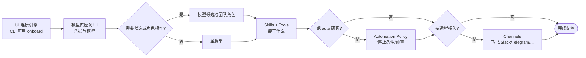

# Agent 配置

**使用 MiraUI 时，首选 [模型供应商界面](./providers-and-runtime.md#首选在-miraui-中设置)**：配置凭据、拉取模型、分配主模型/团队角色并保存。JSON 与环境变量用于纯 CLI、自动化部署或 UI 未提供的字段。

本节覆盖 `{{PROJECT_CORE_NAME}}` 的全部运行时配置：从初始化、模型/Provider 选择，到调用工具与外部 channel。

## 页面列表

| 页面 | 何时看 |
| --- | --- |
| [onboard 与 workspace 初始化](./onboard-and-workspace.md) | 第一次安装；想换 workspace 位置；检查已有配置 |
| [Provider 与运行时参数](./providers-and-runtime.md) | 首选 UI 设置凭据、拉取/分配模型、运行参数与模型参数规则；高级字段参考 |
| [模型选择与候选回退](./model-router.md) | 设置默认模型与候选、团队角色模型 |
| [Skills 与 Tools](./skills-and-tools.md) | 想知道有哪些技能可调用、怎么挂自定义 MCP server |
| [Auto 模式与 Automation Policy](./automation-policy.md) | 当前实验 Run 的目标/预算与旧研究编排停止策略 |
| [记忆与 Python SDK](./memory-and-sdk.md) | 上下文压缩、Dream 版本检查、程序调用 |
| [Channel 配置](./channels.md) | 想把 Agent 接到飞书/Slack/Telegram/钉钉/邮件 |

