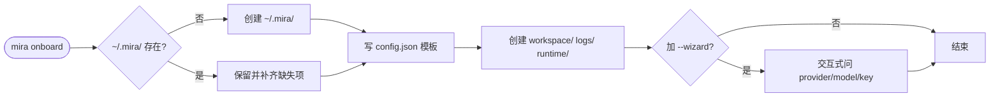

# onboard 与 workspace 初始化

## 这一页解决什么

- 第一次通过 PyPI / 源码装完完整 `{{PROJECT_CORE_NAME}}` CLI 后，`mira onboard` 到底做了哪些事？
- `~/.mira/` 里都有什么、各文件作用？
- 怎么换 workspace 位置？多人 / 多机器怎么搬？
- 已有旧配置与项目目录如何继续使用？

> 如果你只下载了 GitHub Release 里的预构建 `mira-engine`，它不包含 `mira onboard`。预构建版只负责管理本机 gateway 服务，初始化请使用原生 MIRA-UI（推荐 MIRA-bundle）或改用 PyPI / 源码安装得到完整 `mira` CLI。

## 使用 UI 时从哪里开始

桌面 App 和 Web UI 连接引擎后，优先通过 **模型供应商** 配置 Provider 与主模型，通过 **设置** 管理工作区；操作见 [Provider UI 指南](./providers-and-runtime.md)。以下 onboard 和配置文件说明面向完整 CLI、迁移与高级部署。

## `mira onboard` 实际做的事



普通初始化与向导不同：`--wizard` 可以进行登录与配置保存。已有配置应按向导提示检查后保存，不应假定向导完全离线。

## 工作区目录结构

```
~/.mira/
├── config.json                    # 主配置（模型、provider、tools、channels）
├── workspace/                     # 默认工作区；实际项目目录按创建设置
│   ├── PRJ-0001/
│   │   ├── task_plan.json         # 旧计划项目状态；新模块见下文
│   │   ├── data/                  # 原始/处理后数据
│   │   ├── experiments/           # 每个实验的脚本+输出
│   │   │   └── exp-001/
│   │   │       ├── run.py
│   │   │       ├── best_model.pt
│   │   │       └── metrics.json
│   │   └── result/
│   │       └── exports/           # 最终交付物
│   │           ├── experiment_report.md
│   │           └── presentation.pdf
│   └── PRJ-0002/...
├── logs/
│   ├── agent-service.log          # 引擎日志（轮转）
│   └── gateway.log
└── runtime/
    └── diagnostics/               # mira-engine doctor --export 产物
```

## 当前模块项目的目录

创建项目可设置名称、父目录和最终路径。新模块以 `<project>/.mira/modules/<run-id>/module.json` 保存状态，Artifact 和持久化事件也在该项目 `.mira/` 中；并非所有项目都在默认 workspace 的 `PRJ-*` 目录。详见 [状态与存储](../ui/task-plan-and-status.md)。

额外实验输入可在启动窗口授权本次 Run 只读访问，不授予外部写入权限。参见 [实验输入](../ui/experiment-inputs.md)。

## 关键配置字段

使用 UI 的用户优先通过界面保存这些设置。纯 CLI 或高级部署时，再核对引擎实际读取的配置文件（默认 `~/.mira/config.json`）：

```json
{
  "agents": {
    "defaults": {
      "workspace": "~/.mira/workspace",
      "provider": "auto",
      "model": "anthropic/claude-opus-4-5",
      "maxTokens": 8192,
      "temperature": 0.1,
      "maxToolIterations": 200,
      "timezone": "Asia/Shanghai"
    }
  },
  "providers": {
    "anthropic": { "apiKey": "sk-ant-..." }
  }
}
```

| 字段 | 别名（snake_case） | 默认 | 何时改 |
| --- | --- | --- | --- |
| `agents.defaults.workspace` | — | `~/.mira/workspace` | 想把数据放到大盘 / 共享盘 |
| `agents.defaults.provider` | — | `auto` | 想强制走某 provider，不靠 model 名匹配 |
| `agents.defaults.model` | — | `anthropic/claude-opus-4-5` | 切默认模型 |
| `agents.defaults.timezone` | — | `UTC` | dream/cron 调度按本地时区 |
| `agents.defaults.maxToolIterations` | `max_tool_iterations` | `200` | 长任务过早被掐断时上调 |
| `agents.defaults.contextWindowTokens` | `context_window_tokens` | `65536` | 模型支持窗口 < 64k 时下调 |
| `agents.defaults.unifiedSession` | `unified_session` | `false` | 一人多端共享会话 |

> 配置文件支持 **camelCase 与 snake_case 混用**（pydantic alias）。建议团队内统一用 camelCase。

## 换工作区位置

### 方案 A：改配置（推荐）

```json
{ "agents": { "defaults": { "workspace": "/data/mira/ws" } } }
```

然后：

```bash
mkdir -p /data/mira/ws
mira status        # 确认配置的 workspace
mira-engine restart  # 已安装服务时，让运行实例重新读取配置
```

### 方案 B：临时覆盖（一次性）

```bash
mira agent -w /tmp/scratch-ws -m "..."
mira gateway -w /data/mira/ws
```

### 方案 C：环境变量（配置未显式指定该字段时）

```bash
export MIRA_AGENTS__DEFAULTS__WORKSPACE="/data/mira/ws"
```

当前加载路径优先使用配置文件中的显式字段。若文件已写有 workspace，上面的 export 不会将它覆盖；应直接修改配置或采用相应 CLI 的 `-w`。

## 多机器迁移

先复制到目标机器的独立备份目录，核对配置与项目路径后再选择恢复范围：

```bash
rsync -av ~/.mira/ user@host:~/mira-backup/
```

不要漏配置、workspace 与创建在其他位置的项目目录。系统服务定义、PID/锁和运行态文件应在目标机器重新建立，不应原样恢复成运行实例。配置含凭据，按目标机器的访问控制保存。

## 已有配置与旧目录

当前引擎没有自动将 `~/.medpilot` 改名为 `~/.mira`，也不自动映射 `MEDPILOT_*` 环境变量。已有旧数据时先备份，使用新配置明确指向要继续使用的 workspace/项目；不要照旧说明整体覆盖当前数据目录。

当前仍支持 `channels.web` 到 `channels.ui` 等配置兼容转换；这与迁移整个数据目录是不同操作。

## 验收检查

- [ ] `mira status` 全绿，`workspace` 路径符合预期。
- [ ] `~/.mira/workspace` 可读可写（在实际 workspace 中创建并清理一个专用测试文件）。
- [ ] `{{PROJECT_UI_NAME}}` 能连上后端，能看到（哪怕是空的）项目列表。
- [ ] `~/.mira/logs/` 持续有新行写入（运行 `mira gateway` 后观察）。
