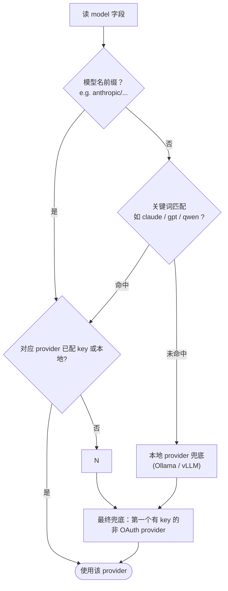

# Provider 与运行时参数

使用 MiraUI 时，**首选「模型供应商」界面配置 Provider、模型和运行参数**。桌面 App 与 Web UI 使用同一操作入口；无须手动编辑配置文件。纯 CLI、部署自动化以及界面尚未提供的字段，再使用下文的高级配置。

## 首选：在 MiraUI 中设置

### 1. 打开模型供应商

先确认 UI 已连接引擎，然后选择以下任一入口：

- 顶部工具栏的四格图标，悬停提示 **模型供应商**（英文 **Providers**）。
- **设置 → 管理供应商**（英文 **Settings → Manage providers**）。

左侧可以搜索供应商，按「已启用 / 已禁用」分组。选择要使用的供应商，打开详情中的 **启用** 开关。


*当前 MiraUI 实际组件截图；密钥预览、模型列表与绑定为隔离演示数据，右侧拉取结果由模拟接口提供，不表示真实账号已通过连接测试。*

### 2. 填写凭据与地址，测试后保存

| 界面项 | 如何填写 |
| --- | --- |
| **API Key** | 填该供应商的凭据；已配置时留空保留原密钥，不会清除它。界面只显示脱敏预览 |
| **API Base** | 官方服务可按输入框提示留空使用默认地址；代理、私有服务或指定区域填写实际 endpoint |
| **启用** | 将供应商加入已启用组；仍需选定主模型，启用本身不会切换当前模型 |
| **测试连接** | 用当前输入的密钥与地址检查供应商的模型获取能力；不会保存这些输入 |
| 右上角 **保存** | 将变更保存到当前连接的引擎，并返回最新配置 |

首次配置可先点击 **测试连接**，确认无鉴权/地址错误，再点击 **保存**。已保存的主模型不能为空；已有配置时可先保留它，完成接入保存后再选择新模型。若初次保存报主模型无效，可先在下方「活动模型」填入供应商给出的真实模型 ID，再保存。

**先保存新密钥/地址，再点击「从供应商拉取」**：拉取读取引擎已保存的配置，不使用尚未保存的输入。「连接成功」主要说明模型获取接口可用，并不保证所选模型的生成、工具调用或权限全部可用；最后仍应发起一次简短对话确认。

### 3. 拉取模型，设为主模型，再保存

1. 点击 **从供应商拉取**。返回结果显示在右侧 **可用模型**，不会自动加入自己的模型列表。
2. 对需要的模型点击 **添加**，或点击 **全部添加**。不支持模型列表获取的服务，可在输入框手动填写真实模型 ID 后点击 **添加**。
3. 在已添加的模型行点击 **设为主模型**；也可在下方 **活动模型 → 主模型** 中选择供应商并填写模型。
4. 点击右上角 **保存**，等到「供应商已保存」，再关闭界面。

模型列表是自己的常用模型清单；**添加**不等于启用该模型，**移除**也不会删除供应商服务器上的模型。切换供应商时，应核对主模型属于该接入，避免把另一家服务的 ID 发到当前网关。

### 4. 为团队角色分配模型（可选）

在模型行右侧的小箭头打开 **分配角色** 菜单，选择 **设为指导者 / 设为执行者 / 设为评审员**。也可在「活动模型」区域逐项选择各角色的供应商和模型，然后 **保存**。


*实际菜单局部截图；展示可选操作，未调用真实模型。*

- **指导者**：规划方向、决策与任务分配。
- **执行者**：执行批准后的具体任务。
- **评审员**：只读审阅与计划把关。

这些绑定供 **团队 Profile** 使用，各角色可选不同供应商；角色模型留空表示继承主模型及其供应商；显式填写角色模型时，「自动检测」按该模型解析接入。连接旧引擎时若提示不支持角色绑定，应先核对 UI/引擎版本。设置不会改写历史尝试的有效 Profile 与结果。

### 5. 调整运行参数与模型参数（可选）

左侧 **运行参数** 可设置推理强度、最大工具迭代次数、自动模式最大轮次以及工具工作区限制，修改后仍需点击右上角 **保存**。


*当前运行参数编辑器局部截图，使用演示配置。自动模式最大轮次属于对应旧自动续跑路径；当前实验 Run 的逐次确认与目标/预算见 [实验输入与执行](../ui/experiment-inputs.md)。*

左侧 **模型参数** 可添加按模型名称匹配的请求参数规则：

1. 点击 **添加规则**，填写模型匹配字符串；支持通配符或不区分大小写的子串。
2. 添加参数名并选择 **数字 / 文本 / 布尔 / 忽略（不发送）**。例如某模型不接受 `temperature`，可以设置为「忽略」。
3. 点击 **保存**。规则覆盖内置默认值，按模型名匹配，并非仅作用于当前选中的供应商；只添加服务确实支持的参数。


*实际模型参数编辑器截图；示例用于说明界面，不是所有模型通用的推荐配置。没有特殊需要时保持规则为空。*

### 保存到哪里，何时生效

保存写入的是 **当前连接的引擎配置**：本地模式写本机，远程模式写服务器，影响使用同一引擎的客户端。不能假定远程保存会修改本机的 `~/.mira/config.json`。

当前 gateway 会接收 UI 保存并重新加载运行时配置，常规 Provider/模型修改无需手动重启。保存失败时先处理界面错误、后端连接与文件权限；进行中的任务不应被视为已按新配置重新执行，验证切换请新开一次对话或运行。

OAuth 供应商在此页管理模型与绑定，**不显示普通 API Key 输入，也没有登录按钮**。登录应使用专用引导流程；纯 CLI 使用 `mira onboard --wizard`。不要把 API Key 粘贴成 OAuth token。

## 高级参考：Provider 清单与配置文件

以下字段面向纯 CLI、批量部署与未暴露在界面中的参数。使用 UI 的用户可在完成上述步骤后跳过 JSON 示例。表中的型号仅为接入示例，不代表当前账号可用目录，优先使用实际返回的模型 ID。

### 内置 Provider 清单

| Provider key | 说明 | 鉴权方式 | 典型 model 字段 |
| --- | --- | --- | --- |
| `openai` | OpenAI 官方 | API key | `openai/gpt-4o`、`openai/gpt-4o-mini` |
| `anthropic` | Anthropic 官方 | API key | `anthropic/claude-opus-4-5`、`claude-sonnet-4-5` |
| `azureOpenai` | Azure OpenAI（model = deployment 名） | API key + `apiBase` | `azure_openai/<deployment>` |
| `openrouter` | OpenRouter 网关 | API key | `openrouter/anthropic/claude-3.7-sonnet` |
| `aihubmix` | AiHubMix 国际/国内网关 | API key + 可选 `extraHeaders` | `aihubmix/...` |
| `siliconflow` | SiliconFlow 硅基流动 | API key | `siliconflow/Qwen/Qwen2.5-72B-Instruct` |
| `volcengine` / `byteplus` | 火山引擎 / 国际版 | API key | `volcengine/doubao-...` |
| `deepseek` | DeepSeek 官方 | API key | `deepseek/deepseek-chat`、`deepseek-reasoner` |
| `dashscope` | 阿里 DashScope | API key | `dashscope/qwen-max` |
| `zhipu` | 智谱 GLM | API key | `zhipu/glm-4.5` |
| `moonshot` | 月之暗面 Kimi | API key | `moonshot/kimi-...` |
| `minimax` | MiniMax | API key | `minimax/...` |
| `mistral` | Mistral | API key | `mistral/mistral-large-latest` |
| `gemini` | Google Gemini | API key | `gemini/gemini-2.0-flash` |
| `groq` | Groq | API key | `groq/llama-3.1-70b-versatile` |
| `stepfun` | 阶跃星辰 | API key | `stepfun/...` |
| `xiaomiMimo` | 小米 MIMO | API key | `xiaomi_mimo/...` |
| `qianfan` | 百度千帆 | API key | `qianfan/...` |
| `ollama` | 本地 Ollama | 无（本地） | `ollama/qwen2.5:14b`、`llama3.2` |
| `vllm` | 本地 vLLM | 无（本地） | `vllm/<model>` |
| `ovms` | OpenVINO Model Server | 无（本地） | `ovms/<model>` |
| `custom` | 任意 OpenAI 兼容 endpoint | 自填 `apiKey` + `apiBase` | `custom/<whatever>` |
| `openaiCodex` | OpenAI Codex（OAuth） | OAuth 登录 | `openai_codex/...` |
| `githubCopilot` | GitHub Copilot（OAuth） | OAuth 登录 | `github_copilot/...` |

> OAuth 凭据由专用登录流程托管，不能按普通 API Key 保存。完整 CLI 可用 `mira onboard --wizard` 登录；预构建 `mira-engine` 本身不能独立完成登录。

### 常见配置文件示例

### OpenAI 官方

```json
{
  "agents": { "defaults": { "provider": "openai", "model": "openai/gpt-4o" } },
  "providers": { "openai": { "apiKey": "sk-..." } }
}
```

### Anthropic 官方

```json
{
  "agents": { "defaults": { "provider": "anthropic", "model": "anthropic/claude-opus-4-5" } },
  "providers": { "anthropic": { "apiKey": "sk-ant-..." } }
}
```

### OpenRouter（一把钥匙调全家）

```json
{
  "agents": { "defaults": {
    "provider": "openrouter",
    "model": "anthropic/claude-sonnet-4-5"
  }},
  "providers": { "openrouter": { "apiKey": "sk-or-v1-..." } }
}
```

> 用 OpenRouter 时 `model` 既可以写 `anthropic/claude-sonnet-4-5`（简短），也可以写 `openrouter/anthropic/claude-sonnet-4-5`（带前缀）。

### Azure OpenAI（注意 model = deployment 名）

```json
{
  "agents": { "defaults": {
    "provider": "azureOpenai",
    "model": "azure_openai/my-gpt-4o-deployment"
  }},
  "providers": {
    "azureOpenai": {
      "apiKey": "<azure-key>",
      "apiBase": "https://my-resource.openai.azure.com"
    }
  }
}
```

### 任意 OpenAI 兼容 endpoint（`custom`）

```json
{
  "agents": { "defaults": { "provider": "custom", "model": "custom/qwen2.5-72b" } },
  "providers": {
    "custom": {
      "apiKey": "<key>",
      "apiBase": "https://my-gateway.example.com/v1",
      "extraHeaders": { "X-Tenant": "lab-skmr" }
    }
  }
}
```

### 本地 Ollama

```json
{
  "agents": { "defaults": { "provider": "ollama", "model": "qwen2.5:14b" } },
  "providers": { "ollama": { "apiBase": "http://localhost:11434" } }
}
```

### 本地 vLLM

```json
{
  "agents": { "defaults": { "provider": "vllm", "model": "vllm/Qwen/Qwen2.5-32B-Instruct" } },
  "providers": { "vllm": { "apiBase": "http://localhost:8000/v1" } }
}
```

### OAuth：OpenAI Codex / GitHub Copilot

```bash
mira onboard --wizard
# → 选 openai-codex 或 github-copilot → 浏览器登录
```

不要在 config.json 里写 key——`openaiCodex` / `githubCopilot` 字段不会由普通配置保存流程序列化 OAuth 凭据，token 由专用流程托管。只安装预构建 `mira-engine` 时，请改用原生 UI 引导或先安装完整 `mira` CLI 完成登录。

Azure 适配器当前使用 Responses API，并在资源地址后拼接 `openai/v1/`。`apiBase` 填资源根地址；不再按旧说明设置 `extraHeaders.api-version`。

## `provider: "auto"` 的匹配规则



实战建议：**只要不是 100% 依赖关键词推断，建议显式写 `provider`，避免被自动匹配带偏。**

## 运行时参数怎么调

| 字段 | 默认 | 调高的代价 | 调低的代价 |
| --- | --- | --- | --- |
| `maxTokens` | `8192` | 单回合更慢、更贵 | 输出可能被截断 |
| `temperature` | `0.1` | 输出更跳 | 输出更死板 |
| `maxToolIterations` | `200` | 长任务有保障，但失控时烧钱 | 长任务可能被掐断 |
| `maxToolResultChars` | `16000` | 上下文吃紧 | 工具输出被截断 |
| `contextWindowTokens` | `65536` | 模型窗口够才有意义 | 早早触发上下文压缩 |
| `reasoningEffort` | `null` | 请求模型支持的推理强度；成本和行为依模型而定 | 关掉则全速但不深思 |
| `providerRetryMode` | `standard` | `persistent` 死磕同一 provider | `standard` 更早 fallback |

研究/工程任务的常用基线：

```json
{ "agents": { "defaults": {
  "temperature": 0.1,
  "maxTokens": 8192,
  "maxToolIterations": 80,
  "maxToolResultChars": 16000,
  "contextWindowTokens": 128000,
  "reasoningEffort": null,
  "providerRetryMode": "standard"
}}}
```

`reasoningEffort` 取值：`"low"` / `"medium"` / `"high"` / `"adaptive"` / `null`。仅对支持思维链的模型（Claude `extended thinking`、OpenAI o-series 等）有效。

## 环境变量（适合 CI / Docker）

`MIRA_*` 可提供未被配置文件显式指定的值，嵌套字段用 `__`。已写在配置文件中的值优先，修改已有模型应在 UI/配置文件中操作；也可在字符串配置中使用 `${VAR}`，由运行时解析。

```bash
export MIRA_AGENTS__DEFAULTS__MODEL="openai/gpt-4o"
export MIRA_AGENTS__DEFAULTS__TEMPERATURE=0.0
export MIRA_PROVIDERS__OPENAI__API_KEY="sk-..."
export MIRA_PROVIDERS__OPENROUTER__API_KEY="sk-or-..."
```

## 验收检查

- [ ] UI 已连接正确的本地或远程引擎；供应商已启用，主模型与接入匹配。
- [ ] 修改后点击 **保存**，重新打开页面仍能看到模型和绑定；已存密钥保持脱敏。
- [ ] **测试连接** 无错误；新密钥/地址已保存后再拉取模型。
- [ ] 新开一次简短对话得到真实回复，确认生成权限与模型 ID；连接测试不能替代这一步。
- [ ] 纯 CLI 用户用 `mira status` 核对配置，再用 `mira agent -m "ping"` 验证实际请求。
