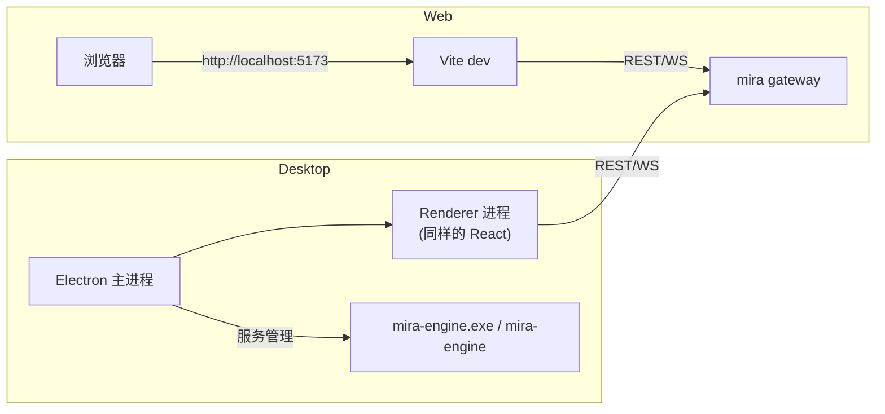

# Web / Desktop 双模式

## 它解决什么

`{{PROJECT_UI_NAME}}` 同一份代码可以跑在两种容器里：

- **Web 模式**：浏览器访问 Vite dev server / 静态构建产物。
- **Desktop 模式**：Electron 包裹的桌面应用，可联调可打包安装。

> 两者共用 React 组件、状态机、API client，桌面版另有本地文件选择、引擎服务管理与更新能力。



## 用哪个

Web 和 Desktop 均首选 **模型供应商** 界面设置凭据、主模型与团队角色，无须编辑 JSON；详见 [Provider UI 指南](../agent-config/providers-and-runtime.md)。保存作用于当前连接的引擎，远程模式修改服务器配置。

| 你的需求 | 选 |
| --- | --- |
| 团队多人共用一份后端 | Web |
| 远程访问（SSH 转发 / 内网） | Web |
| 个人工作站、希望开机即用 | Desktop |
| 离线/无网络环境 | Desktop（配合本地 Ollama） |
| 需要在 “Finder/Explorer 里打开文件” | Desktop |
| 想给非技术同事一个安装包 | Desktop |

## Web 模式

### 开发联调

```bash
cd mira-ui
npm install
npm run dev
# 访问 http://localhost:5173
```

可通过 `.env.local` 指定后端地址：

```bash
VITE_API_URL=http://localhost:18790/api
VITE_WS_URL=ws://localhost:18790/ws
```

### 静态构建

```bash
npm run build:web
# 产物在 dist/，把它扔到任意静态服务器（nginx / caddy）即可
```

把 nginx 反代加上 `/api`、`/ws` 与 `/ws/workflow/v1` 转到 `mira gateway` 端口就完成部署。模板见 [自托管部署](../../deployment/self-hosted.md)。

## Desktop 模式

Desktop release 现在分成两类：

| 桌面包 | 适合谁 | 关键行为 |
| --- | --- | --- |
| `MIRA-standalone` | 远程连接用户、已经手动安装引擎的用户 | 只提供 UI，不内置本地 `mira-engine` 服务生命周期 |
| `MIRA-bundle` | 单机本地使用、希望开箱即用的用户 | 内置对应平台的 `mira-engine` 二进制，首启自动注册并拉起本地服务 |

> 如果你主要连远程 `mira gateway`，应优先下载 `standalone`；如果你希望“一台电脑装完就能本地跑”，应下载 `bundle`。

### 联调（同时拉起 Electron + Vite）

```bash
npm run dev:electron
```

Electron 主进程会：

1. 起一个内部的 Vite dev server。
2. 打开窗口加载它。
3. 使用桌面引擎桥接管理已配置的本地服务，或按设置连接手动/远程后端。

### 打包

```bash
npm run build:electron     # 构建 Electron main/preload/renderer，不出安装包
npm run dist               # 出 standalone 安装包到 release/
npm run dist:bundle:mac    # 出 macOS bundle 安装包
npm run dist:bundle:win    # 出 Windows bundle 安装包
npm run build:desktop      # 等价 build:web + build:electron
```

产物位置：

| 类型 | 典型文件 |
| --- | --- |
| standalone | `release/MIRA-standalone-<ver>-mac-<arch>.dmg`、`release/MIRA-standalone-<ver>-win-<arch>-setup.exe` |
| bundle | `release-bundle/MIRA-bundle-<ver>-mac-<arch>.dmg`、`release-bundle/MIRA-bundle-<ver>-win-<arch>-setup.exe` |
| Linux | 当前只提供 standalone 桌面产物（`.AppImage`） |

### Electron 怎么找 `mira-engine`

当前 resolver 先查安装包/开发资源中的 bundled engine；没有可用载荷时才查 `MIRA_ENGINE_PATH`。它不扫描系统 PATH，环境变量也不能覆盖已经找到的 bundled engine。

开发联调没有内置载荷时，可将 `MIRA_ENGINE_PATH` 设为实际可执行路径。已经自行启动的本地或远程 gateway，可以使用手动连接模式。

## 本机服务控制

桌面设置中的本地模式可启动、停止、重启引擎并刷新状态。浏览器没有 Electron 服务桥接；远程部署应在 gateway 主机管理服务。停止/重启前会提示断线与任务中断风险，详见 [本地服务](../../deployment/local-engine-service.md)。

## localStorage / 设置迁移

UI 的本地设置（API 地址、主题、最近项目等）存在浏览器 `localStorage`，key 为 `mira-ui-settings`。

从 MedPilot 升级时，UI 会在第一次启动检测到旧 key `medpilot-ui-settings`，把内容拷贝到新 key 后删除旧的。**对你来说是无感的**。

## 验收检查

- [ ] Web 模式下首页与后端接口可正常加载，检查真实连接状态。
- [ ] Desktop 模式下首次启动若未配置 engine，UI 会提示安装 / 选择 `mira-engine`，或推荐改用内置引擎的 `MIRA-bundle`。
- [ ] 打包产物在干净的目标系统上能直接启动并连上后端（或已安装的本地服务）。
- [ ] 切换 Web/Desktop 模式后，项目列表、设置等数据一致（前提是连同一个后端）。
