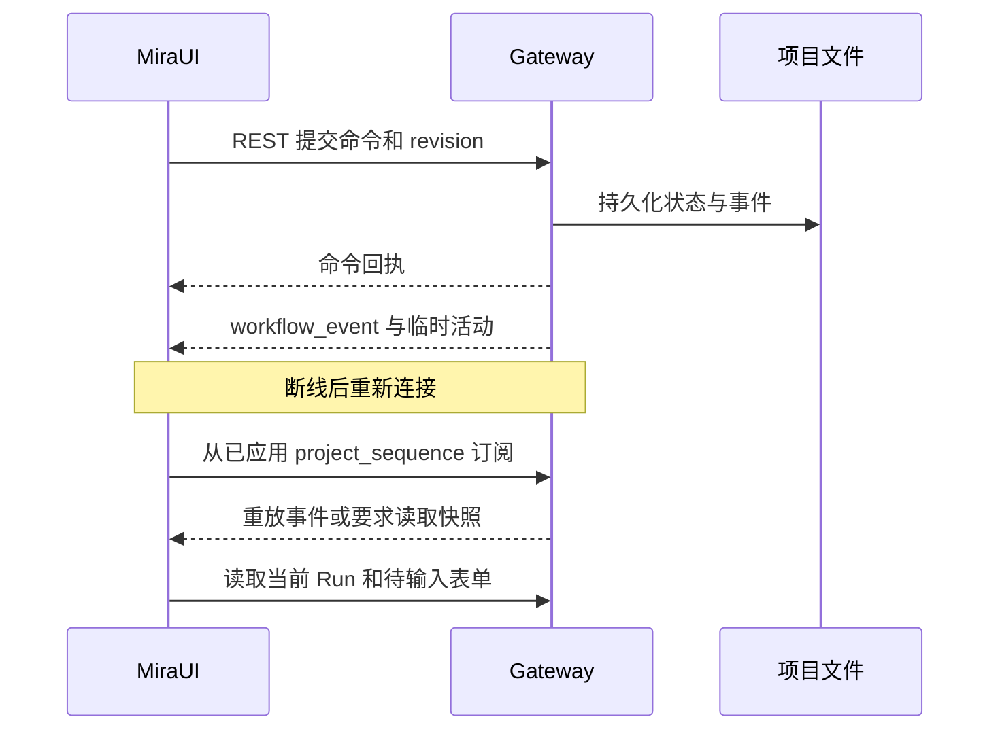

# 实时同步与断线恢复

当前模块使用 **REST 命令和快照 + workflow WebSocket 事件**。普通对话仍使用 `/ws` 发送消息和接收回复；旧计划保留自己的 REST 入口。

## 已实现的端点

下表中的路径由 gateway 提供。若 UI 的 API URL 已包含 `/api`，配置时不要再拼一个 `/api`。

| 方法 | 路径 | 用途 |
| --- | --- | --- |
| GET | `/api/health`、`/api/version` | 健康与版本 |
| GET | `/api/projects` | 项目列表 |
| GET | `/api/workflow/v1/contract` | 模块协议发现 |
| GET | `/api/workflow/v1/projects/{project_id}` | 项目快照 |
| GET / POST | `/api/workflow/v1/projects/{project_id}/runs` | 列出 / 创建运行 |
| GET | `/api/workflow/v1/projects/{project_id}/runs/{run_id}` | 当前运行 |
| POST | `/api/workflow/v1/projects/{project_id}/runs/{run_id}/commands` | 暂停、恢复、取消、重试、提交交互等 |
| GET | `/api/workflow/v1/projects/{project_id}/events` | 按项目序号读取事件 |
| GET / POST | `/api/workflow/v1/projects/{project_id}/artifacts` | 列出 / 导入产物 |
| GET | `/api/workflow/v1/projects/{project_id}/artifacts/{artifact_id}/content` | 获取产物内容 |
| WS | `/ws/workflow/v1` | 模块事件、活动与回复流 |
| WS | `/ws` | 普通对话与 Run 对话的消息入口 |
| GET | `/api/plan`、`/api/plan/contract` | 旧计划与其合同 |

## 持久化事件与临时活动

- **持久化**：运行创建、开始、等待输入、完成、失败，交互请求和回答，Artifact 发布等。每个项目有递增的 `project_sequence`，保存在 `events.jsonl`。
- **临时**：当前操作提示和 token 增量。它们帮助查看进度，不是完成证据，也不会作为旧 token 流在重连后全部回放。

客户端按项目游标重放事件并去重；需要重建时会重新读取快照。两个窗口可以订阅同一个项目，但不要同时修改同一旧 revision。

## 暂停与取消

运行中暂停或取消可能先保存为待处理请求，到执行安全边界后才确认。外部任务的停止属于尽力处理，不保证任何远程作业都立即结束；查看实际回执与状态。

停止引擎会让 UI 断线，任务不保证自动恢复。服务恢复后先检查 Run、检查点和已有文件，再决定继续；不要直接重复一个可能已经启动的外部任务。

## 自托管反向代理

代理需要同时支持 `/api/`、`/ws` 和 **`/ws/workflow/v1`**，后两个路径都需要 WebSocket Upgrade。只代理旧 `/ws` 会导致对话正常但模块事件失败。配置见 [自托管部署](../../deployment/self-hosted.md)。
